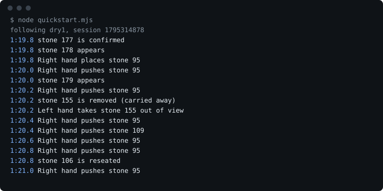

# pDigger Factory SDK for TypeScript

Read tray reports from a pDigger Factory camera unit or replay a recording in TypeScript or JavaScript. Use async
iterables to follow a live unit and the optional three.js views to draw what it sees.

Simple mode gives you one report per tray. It lists the stones added, removed or moved and flags uncertain changes.
Advanced mode gives you the events, frames and tracking evidence behind each report.

## Install

The built package runs on Node 18+, Deno 2, Bun 1 and browsers. For the `.ts` examples below, use Node 22.18 or
later on the 22.x LTS line, or Node 24+. Build the package in the clone first.

```sh
git clone https://github.com/eprojac/pdigger-factory-sdk-ts
cd pdigger-factory-sdk-ts
npm ci
npm run build
```

To use this build in another project, run `npm pack` in the clone. From a sibling project, run
`npm install ../pdigger-factory-sdk-ts/pdigger-factory-sdk-0.1.0.tgz`. The core package has no runtime dependencies.

<a id="simple-mode-one-report-per-tray"></a>

## Read a tray report

The repository includes a short recording of a worker sorting stones on a tray. Run the report example on that file.

```sh
node examples/quickstart-reports.ts fixtures/recordings/dry1-0018-0153.ndjson.gz
```

In your application, import `Replay` from `pdigger-factory-sdk` and pass a file path or recording URL as `source`.

<!-- snippet: examples/quickstart-reports.ts#reports -->
```ts
const replay = await Replay.open(source);
for (const report of await replay.trayReports()) {
  console.log(report.describe());
}
```

The first two lines for `dry1-0018-0153` show the tray totals and the first removal.

```text
tray 1 (2026-11-22T02:38:47.0Z), 0:22.5 to 2:24.0: 11 removed, 13 added, 8 moved, not complete: 18 unclear, 1 not sure
  0:45.5 removed 20261122T023847.0Z-1-117 from (0.68, -1.06) (0.98)
```

The SDK marked six of the 11 removals as certain and five as unclear. The number at the end of each change is its
confidence score. [Walk through this report](docs/tutorials/00-start-here.md).

To replay a longer recording, pass its path or URL to the same command.
[Browse the published recordings](https://factory.pdigger.com/developers/data/).

## Follow a live unit

Use the same example with your unit’s address to print a report as each tray leaves the camera.

```sh
PDIGGER_FACTORY_URL=http://factory-orin.local:8120 node examples/quickstart-reports.ts --follow
```

Use `JSON.stringify(report)` to get the fields for a database or spreadsheet.
[Report example source](examples/quickstart-reports.ts).

<a id="advanced-mode-follow-the-camera"></a>
<a id="advanced-mode-replay-a-recording"></a>

## Read individual events

The interpreter can also tell you when a hand lifts a stone, which stones it pushes and where it places them. The
live example prints events from whichever source the unit is watching.

```sh
node examples/quickstart.ts
```

<!-- snippet: examples/quickstart.ts#quickstart -->
```ts
import { FactoryClient } from "pdigger-factory-sdk";

const factory = new FactoryClient(process.env.PDIGGER_FACTORY_URL ?? "http://factory-orin.local:8120");
const state = await factory.session.state();
console.log(`following ${state.video}, session ${state.session}`);

for await (const event of factory.interpreter().events()) {
  console.log(event.describe()); // e.g. "21:17.8 Right hand lifts stone 2660"
}
```

To inspect events from a recording, pass its URL to the replay example.

```sh
node examples/replay.ts https://factory.pdigger.com/developers/data/dry1.world.ndjson.gz
```

[Live event example](examples/quickstart.ts) · [Replay example](examples/replay.ts)



Events from the fake unit playing joined-mid-move, dry1 frames 399–420.

<a id="advanced-mode-in-three-layers"></a>

## Choose an API

| Task | SDK entry point | Example | Guide |
| --- | --- | --- | --- |
| Follow hand movements and stone events | `factory.interpreter().activities()` | [Source](examples/levels.ts) | [Interpreter](docs/interpreter.md) |
| Read individual frames and late layers | `factory.streams.frames` | [Source](examples/streams.ts) | [Streams](docs/streams.md) |
| Request a frame, map or draw list | `factory.api.getFrame` | [Source](examples/levels.ts) | [HTTP API](docs/low-level.md) |

<a id="trays-ids-never-reused-facts-never-revised"></a>

Each tray stone has a stable ID, even if the camera tracker loses it and assigns another ID.
[How the SDK tracks tray stones](docs/interpreter.md#trays-and-tray-stones).

<a id="live-cameras-and-the-shared-session"></a>

Selecting a camera or seeking a recording changes the source or playhead for everyone watching that unit.
[Live camera tutorial](docs/tutorials/03-live-cameras.md).

## Errors

Use `FactoryError` to handle SDK failures. Branch on the stable error code when deciding whether to retry or choose
another frame. [Error handling and retries](docs/low-level.md).

## Async notes

Use `for await` to consume a stream. Leaving the loop closes its connection. Pass an `AbortSignal` to cancel a
pending call or read. In a browser, serve the page from the unit’s origin because the API does not send CORS
headers.

## Testing your code

Import `FakeFactory` from `pdigger-factory-sdk/testing` and pass its `fetch` implementation to the client. You can
control time and inject faults in your tests. [Testing guide](docs/testing.md).

## Visualisation helpers

Install `three` to use `pdigger-factory-sdk/viz`. TypeScript projects also need `@types/three`. The views draw a
tray report, a camera overlay or a 3D scene. [Browser example and API](docs/viz.md).


## Documentation

- [Work through the tutorials](docs/tutorials/README.md)
- [Understand sessions, coordinates and frame layers](docs/concepts.md)
- [Open and replay recordings](docs/replay.md)
- [Look up camera timings on the 20.20 unit](docs/BEHAVIOUR-20.20.md)
- [Browse the HTTP API](https://factory.pdigger.com/developers/api/) · [OpenAPI specification](spec/openapi.yaml)
- [Run the examples in Docker](TESTING.md#the-try-it-image)

Build the TypeScript API reference with `make docs` from the repository root.


## The four languages

All four SDKs produce the same report text for a given recording. [Shared SDK contract](spec/SDK-DESIGN.md).

| SDK | Reports, events, streams and replay | Viewer |
| --- | --- | --- |
| [Go](https://github.com/eprojac/pdigger-factory-sdk-go) | Yes | — |
| [Python](https://github.com/eprojac/pdigger-factory-sdk-python) | Yes | — |
| [Rust](https://github.com/eprojac/pdigger-factory-sdk-rust) | Yes | egui |
| [TypeScript](https://github.com/eprojac/pdigger-factory-sdk-ts) | Yes | three.js |

## Development

Run `make test` from the repository root to check the SDK in Docker. [Test instructions](TESTING.md) ·
[Contributing](CONTRIBUTING.md) · [Release instructions](RELEASING.md)

## Licence

[Apache License 2.0](LICENSE) · [Third-party notices](NOTICE)
