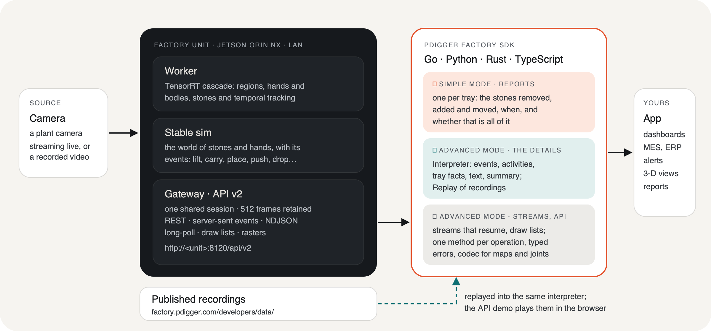
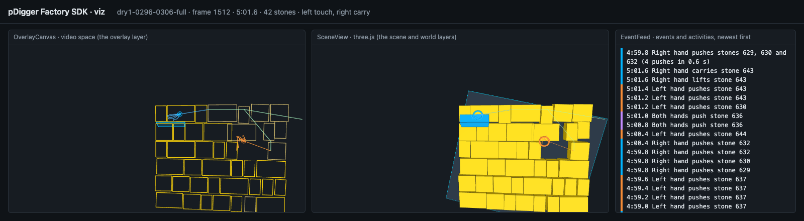

# pDigger Factory SDK for TypeScript

The pDigger Factory unit watches one work area through one camera and interprets it: which hand moved which stone, when,
and where it went. This SDK reads that record from TypeScript or JavaScript with promises, async iterables and
`AbortSignal`, in two modes. Simple mode is one report per tray: which stones were taken off, which were put on and
which moved, when and where on the tray, and whether that is the tray's whole account. Advanced mode is the detail
underneath, for research and for correcting a report that is not complete: plain-language events and activities
(`21:17.8 Right hand lifts stone 2660`), every tray fact with its reason, the typed frame streams, and one call per API
operation. It replays the published recordings offline, draws them with three.js (`pdigger-factory-sdk/viz`), and its
`testing` module answers the API from a recording, so code built on it is tested without a unit.

- Try the API in your browser: https://factory.pdigger.com/developers/api/ (Swagger UI with a demo server)
- Download the recordings: https://factory.pdigger.com/developers/data/
- API reference: built from the doc comments with TypeDoc (`npm run docs`, and on every CI run)



## Install

Until the package is on npm, build it from this repository and install the tarball (`npm install
github:eprojac/pdigger-factory-sdk-ts` does not work yet: the repository has no built `dist/`):

```sh
git clone https://github.com/eprojac/pdigger-factory-sdk-ts
cd pdigger-factory-sdk-ts && npm ci && npm run build && npm pack
npm install <path to>/pdigger-factory-sdk-0.1.0.tgz   # in your project
npm install three @types/three   # only for pdigger-factory-sdk/viz (@types/three for TypeScript)
```

From the first release on, `npm install pdigger-factory-sdk`. Node 18 or newer, Deno 2 (`npm:pdigger-factory-sdk` once
it is on npm), Bun 1 and current browsers: the code uses only standard
`fetch`, web streams and ES modules, and CI runs the built package on Node 18, Deno and Bun (every fixture replayed to
its golden files, an Interpreter on the fake). ES modules with type declarations, which also compile in projects
without Node's types or `esnext.disposable` (CI type-checks them as a browser, a Node and an ESNext project); the core
has no runtime dependencies, and `three` (with `@types/three` for its types) is an optional peer dependency of `/viz`
only. In a browser the client works from a page served by the unit itself: the API sends no CORS headers.

| Import | What |
|---|---|
| `pdigger-factory-sdk` | `FactoryClient`, the Interpreter, `Replay`, streams, the low-level `Api`, models, `codec`, errors |
| `pdigger-factory-sdk/viz` | `SceneView`, `OverlayCanvas`, `EventFeed`, `attachToClient` (three.js) |
| `pdigger-factory-sdk/testing` | `FakeFactory` (the API from a recording, as a `fetch`), `InstantClock`, `ManualClock` |

To try it without installing Node packages, the repository's `Dockerfile` builds a small image with the examples. The
first run below follows a fake unit (`FakeFactory` serving a fixture recording, no network at all), the second a real
one (`--init` lets Ctrl-C stop it):

```sh
docker build -t pdigger-factory-sdk-ts .
docker run --rm --network none pdigger-factory-sdk-ts node --import ./scripts/fake-preload.mjs examples/quickstart.ts
docker run --rm --init -e PDIGGER_FACTORY_URL=http://192.0.2.20:8120 pdigger-factory-sdk-ts
```

Give the unit by its IP address there: `.local` names do not resolve inside a container.

## Simple mode: one report per tray

<!-- snippet: examples/quickstart-reports.ts#reports -->
```ts
const replay = await Replay.open(source);
for (const report of await replay.trayReports()) {
  console.log(report.describe());
}
```

<!-- snippet: examples/quickstart-reports.ts#follow -->
```ts
const factory = new FactoryClient(process.env.PDIGGER_FACTORY_URL ?? "http://factory-orin.local:8120");
for await (const report of factory.interpreter().trayReports()) {
  console.log(report.describe()); // JSON.stringify(report) is the same as data, for your MES or ERP
}
```

The first reads a recording, offline; the second gives the same report from a unit as each tray leaves. The report
of the tray in the fixture recording `dry1-0018-0153` (dry1 from 0:18 to 2:33), real output of
[`examples/quickstart-reports.ts`](examples/quickstart-reports.ts):

```text
tray 1 (2026-11-22T02:38:47.0Z), 0:22.5 to 2:24.0: 11 removed, 13 added, 8 moved, not complete: 18 unclear, 1 not sure
  0:45.5 removed 20261122T023847.0Z-1-117 from (0.68, -1.06) (0.98)
  0:45.5 removed 20261122T023847.0Z-1-127 from (1.14, -1.24) (0.98)
  0:59.4 removed 20261122T023847.0Z-1-126 from (0.35, -1.29) (0.98)
  1:05.4 removed 20261122T023847.0Z-1-105 from (0.49, -0.82) (0.98)
  1:23.6 removed 20261122T023847.0Z-1-112 from (-0.11, -0.84) (0.98)
  1:23.6 removed 20261122T023847.0Z-1-125 from (-0.09, -1.26) (0.98)
  2:24.0 removed 20261122T023847.0Z-1-87 from (0.02, -0.17) (unclear, 0.71)
  2:24.0 removed 20261122T023847.0Z-1-121 from (0.33, -1.27) (unclear, 0.71)
  2:24.0 removed 20261122T023847.0Z-1-128 from (0.56, -1.29) (unclear, 0.71)
  2:24.0 removed 20261122T023847.0Z-1-129 from (0.74, -1.29) (unclear, 0.71)
  2:24.0 removed 20261122T023847.0Z-1-130 from (0.87, -1.27) (unclear, 0.71)
  2:24.0 added 20261122T023943.4Z-1-151 at (0.16, -1.26) (unclear, 0.52)
  2:24.0 added 20261122T024104.0Z-1-177 at (0.02, -0.82) (unclear, 0.96)
```

These are its first fourteen lines; eleven more additions and its eight moves follow. The number that ends each change
is its confidence: how likely it is to be right, from how often changes of its kind were right on 150 trays of the four
complete recordings checked against their video. The unit's speckle check of each tray, part of every report, sets it
([docs/interpreter.md](docs/interpreter.md#confidence)). Keep the changes at or above a threshold of your own: at 0.90
this tray keeps its six certain removals and nine of its thirteen additions, all fifteen right by the camera check.
Below it are the other two stones that left (87 and 129), a stone the worker set down (278), three removals of stones
that stayed (121, 128 and 130) and three additions of stones that came in on the tray (151, 246 and 249).

The camera check is the maintainers' offline test (not published) that matches each stone's speckle in the recording's
video, the tray as it arrived against the tray as it left. The worker pushed most of the other stones while squaring the
rows up: the world lost some of them and saw them again under new ids, and the speckle check finds them again as the
tray leaves, so only one stone is still not sure (98, next to a pushed stone). A hand can also take a stone away and set
another one down in its place, so the SDK links a lost stone to a new world id only with evidence that it is the same
stone (the speckle check, their looks, or no hand near either); without it, the lost stone is removed and the new one
added, both unclear, and the stone's id never goes to another stone. Of the thirteen unclear additions, ten are stones
the worker set down and three came in on the tray. Each change gives the stone's final place in scene units.
`not complete` says what is left open: 18 unclear changes and that one stone. Complete means complete as far as the
world sees. A stone the model stops seeing for good while it stays on the tray is removed: for certain when a hand
touched it just before, else unclear (3 of the 52 certain removals in a camera check of the four complete recordings,
each one a stone a hand had moved). A box seen on an empty slot at the arrival becomes a tray stone. A stone the world
does not have as the tray leaves is not in the account. Nor is one it keeps there without a box while a hand holds it,
or with 30 % or more of its box under the box of a stone no hand holds (none here: the camera counts 44 stones as the
tray leaves, and so does the account, with world 281, which a hand set down six seconds before and the world kept
although the model had not boxed it yet) ([docs/interpreter.md](docs/interpreter.md)). Advanced mode says that stone by
stone ([the first tutorial](docs/tutorials/00-start-here.md) shows how).

## Advanced mode: follow the camera

<!-- snippet: examples/quickstart.ts#quickstart -->
```ts
import { FactoryClient } from "pdigger-factory-sdk";

const factory = new FactoryClient(process.env.PDIGGER_FACTORY_URL ?? "http://factory-orin.local:8120");
const state = await factory.session.state();
console.log(`following ${state.video}, session ${state.session}`);

for await (const event of factory.interpreter().events()) {
  console.log(event.describe()); // e.g. "21:17.8 Right hand lifts stone 2660"
}
```

The Interpreter follows the unit's shared session: whatever it shows, one of the plant cameras live or a recording.
Nothing in your code changes between the two ([live cameras](#live-cameras-and-the-shared-session) shows how to select
a camera and wait out its warm-up). The quickstart has no types in it: saved as `quickstart.mjs` it runs with
`node quickstart.mjs` too.


Real output of [`examples/quickstart.ts`](examples/quickstart.ts) against `FakeFactory` serving the fixture recording
`joined-mid-move` (video dry1, grid frames 399 to 420, recorded from the 20.20 unit): the first fourteen events,
including the left hand taking stone 155 out of view.

## Advanced mode: replay a recording

No unit needed. `Replay` streams a published recording (or a local file, or bytes) and runs the same Interpreter over
it:

<!-- snippet: examples/replay.ts#replay -->
```ts
import { Replay } from "pdigger-factory-sdk";

const replay = await Replay.open(process.argv[2] ?? "https://factory.pdigger.com/developers/data/dry1.world.ndjson.gz");
console.log(`${replay.header?.name ?? "recording"}: ${replay.header?.frames ?? "?"} frames of ${replay.header?.video}`);

for await (const update of replay.updates()) {
  for (const event of update.events) console.log(event.describe());
  for (const activity of update.activities) console.log(`  -> ${activity.describe()}`);
}
console.log((await replay.summary()).describe());
```

Over a fixture excerpt the events, activities and summary it prints are byte for byte the golden files of
`fixtures/golden/`, the same text every pDigger Factory SDK prints.

## Advanced mode, in three layers

Stay on the top one; go down when you need more. All three are on one client.

**High: the Interpreter.** Typed events, activities (moves and push bursts), hand states, the stone inventory, trays
with stone ids never reused and facts never revised, a summary, and plain sentences
([docs/interpreter.md](docs/interpreter.md)).

<!-- snippet: examples/levels.ts#high -->
```ts
// High level: typed events, activities and plain sentences.
const interpreter = factory.interpreter(); // a viewer (the default), so the unit interprets while it runs
const lift = await interpreter.waitFor("lift", { timeout: 60_000 });
console.log("high:", lift.describe());
const { hands, stones } = interpreter.state;
console.log(`high: left hand ${hands.left.state}, right hand ${hands.right.state}, ${stones.size} stones`);
interpreter.close();
```

**Mid: streams.** Frames over SSE that resume after a dropped connection (`Last-Event-ID`), hold a frame whose world
is late and read it back (backfill), flag world revisions, and pass the session's clock, worker, gap and reset events;
the long-poll and raw packets the same way ([docs/streams.md](docs/streams.md)).

<!-- snippet: examples/levels.ts#mid -->
```ts
// Mid level: frames with automatic resume, backfill of late layers and world revisions, plus side events.
for await (const item of factory.streams.frames({ layers: ["world", "overlay"] })) {
  if (item.kind !== "frame") continue; // clock, worker, gap and reset events
  const { g, world, overlay } = item.frame;
  console.log(`mid: frame ${g}: ${world?.stones.length ?? 0} stones, ${overlay?.items.length ?? 0} detections`);
  break; // leaving the loop closes the stream
}
```

**Low: one method per operation.** All 32 operations of the API with typed requests, replies and errors, plus
decoders for the packed maps, bitsets, depth, surfaces, joints and stone tuples ([docs/low-level.md](docs/low-level.md)).

<!-- snippet: examples/levels.ts#low -->
```ts
// Low level: one typed method per operation, typed errors, and decoders for the packed layers.
const frame = await factory.api.getFrame("latest", { layers: ["overlay"] });
const regions = frame.overlay?.regions;
if (regions) {
  const tray = codec.decodeU8Map(regions.tray, regions.rows, regions.cols); // rows x cols, row-major
  console.log(
    `low: frame ${frame.g}: tray covers ${tray?.filter((v) => v > 0).length} of ${regions.rows * regions.cols} cells`,
  );
}
const scene = await factory.api.renderScene3d({ g: frame.g, surface: "vertices" });
const mesh = codec.decodeSurfaceMesh(scene.surface);
console.log(
  `low: scene ${scene.g}: ${scene.stones.length} stones, surface of ${(mesh?.indices.length ?? 0) / 3} triangles`,
);
```

## Trays: ids never reused, facts never revised

The world's stone ids are the engine tracker's: it renames a stone it lost and found again, and it can give a stone's id
to another one (a stone set down where a removed one lay, a row of equal stones pushed one place along). For anything
that must hold over time, use the tray stones. The interpreter follows each tray from the moment it has arrived and
settled to the moment it is about to move out, and gives every stone on it an id that is never reused, no other tray
stone is ever given it (`20261122T023847.0Z-1-117`: first seen at that UTC time, on tray 1, under world id 117). A
tray stone says whether its identity is still sure, and a fact about it is certain or unclear:
`0:45.5 tray 1: stone 20261122T023847.0Z-1-117 was removed` is certain and is never revised, and what the rules cannot
be sure of is reported as unclear, never guessed. `replay.trays()` lists the trays with their two points, the ones to
jump between ([examples/tray-points.ts](examples/tray-points.ts)):

<!-- snippet: examples/tray-points.ts#trays -->
```ts
const trays = await (await Replay.open(source)).trays(); // every tray, with its two points
for (const tray of trays) {
  const window = tray.window();
  if (window === null) continue; // a stop that never settled
  console.log(`tray ${tray.n}: arrived ${clock(window[0])}, leaving ${clock(window[1])}`);
  for (const stone of tray.stones) {
    if (stone.status === "removed" && stone.certain === true) console.log(`  removed: ${stone.id}`);
  }
}
```

Live, `interpreter.trayFacts()` yields the same facts as frames make them, and every event names the tray stone its
world id stands for (`event.trayStone`). On busy trays, where hands push rows of equal stones, the tray rules alone
lose track of many stones; as the tray leaves, the unit's speckle check settles most of them again (on the published
recordings 95.6 % of the stones are sure as their tray leaves where it answers), and every change carries its
confidence. Without an answer for the leaving (hands still at work after the tray's last calm frame), most of those
stones stay not sure and the stones set down are mostly reported as unclear. The SDK sees only the world: a box the
model sees on an empty slot when the tray arrives cannot be told from a stone, and a stone the model stops seeing for
good while it stays on the tray looks removed ([docs/interpreter.md](docs/interpreter.md#trays-and-tray-stones)).

## Live cameras and the shared session

The unit has one shared session: one source, one playhead and one interpretation, the same for every viewer. A control
(`watch`, `seek`, `pause`, `play`, `focus`) changes it for everybody, so every control takes `dryRun: true`. The plant
cameras are sources like the recordings, listed after them by their serials: `factory.cameras()`. Watching one starts a
session that is `connecting` until the camera's first frame, then `warming` while the interpreter runs on its first 3
seconds of frames (none of them is shown), then `live`; `session.untilLive()` waits for that (the select counts as a
viewer for 15 s, so this works on a unit nobody else watches; [examples/live-camera.ts](examples/live-camera.ts)):

<!-- snippet: examples/live-camera.ts#live -->
```ts
const camera = serial === undefined ? await factory.live() : await factory.source(serial); // the first camera, or that
await factory.session.watch(camera); // connecting, then warming up on the camera's first 3 s
const state = await factory.session.untilLive();
const lag = state.live?.lag ?? 0;
console.log(`${camera.id} (${camera.title}) is live: session ${state.session}, ${fmt(lag, 2)} s behind the camera`);

const picture = await factory.session.picture(); // the JPEG the newest frame was interpreted from
console.log(`frame g ${picture.g}: a ${picture.jpeg.length}-byte JPEG`);

for await (const event of factory.interpreter().events()) {
  const at = event.wall === null ? "--:--:--" : new Date(event.wall * 1000).toISOString().slice(11, 19);
  console.log(`${at} UTC  ${event.describe()}`); // on a camera, the wall time is the timestamp that matters
}
```

From then on the frames, the world and the events stream as on a recording, at the camera's rate as far as the unit's
worker keeps up (on the 20.20 unit 1.6 to 3.9 frames a second with build `claude-20261120-looks1`, about 3.6 with build
`claude-20261122-hr4x1`). A camera has no time: `watch(camera, { at })` and a seek reject with `not_seekable` without
sending the select or the seek (a seek reads the session first, a watch of an id reads the catalog; the unit refuses a
select with a time with 400 and a seek with 409), `pause` freezes the shared view, and `play` continues at the live edge
after a new warm-up. A camera has no media either: every frame comes with its picture (`session.picture(g)`). Events
carry a wall time, from the shared state, which on a camera is the timestamp that matters.
[docs/concepts.md](docs/concepts.md#sources-and-the-live-cameras) explains the session, and
[docs/BEHAVIOUR-20.20.md](docs/BEHAVIOUR-20.20.md) gives measurements of the 20.20 unit and its live cameras.

## Errors

Every failure is a `FactoryError` with `status`, `code` (the API's stable error codes, plus `transport`, `decode`,
`live_unavailable`, `live_timeout` and `stream_closed`), `message`, `field`, `retryMs`, `retained`, `waiting`, and the
reply's `headers`. Code is keyed on `code`, never on the message:

<!-- snippet: examples/errors.ts#errors -->
```ts
try {
  await factory.api.getFrame(0); // the unit keeps only its newest frames
} catch (err) {
  if (!isFactoryError(err, "not_retained")) throw err;
  console.log(`frame 0 is gone: the unit keeps frames ${err.retained?.g0} to ${err.retained?.g1}`);
}

try {
  const live = await factory.live();
  console.log(`live camera: ${live.title}`);
} catch (err) {
  if (!isFactoryError(err, "live_unavailable")) throw err;
  console.log("this unit lists no camera: the shared session plays recordings");
}

try {
  await factory.api.getVideo("no-such-video");
} catch (err) {
  if (!isFactoryError(err)) throw err;
  console.log(`${err.status} ${err.code} (field ${err.field}): ${err.message}; retryable: ${err.isRetryable()}`);
}
```

`isRetryable()`, `isNotRetained()` and `isSessionGone()` answer the common questions. GET requests are retried on
connection errors, 429, 502, 503 and 504, waiting the server's `retry_ms`, else `Retry-After`, else an exponential
backoff with full jitter (250 ms, doubling, at most 5 s; 3 retries by default). Controls are retried only on 429,
which the server answers before applying anything. Other 4xx replies are never retried.

## Async notes

- Every call returns a `Promise`; every stream is an `AsyncIterable` for `for await`. Leaving the loop (`break`,
  `return`, a throw) closes the HTTP connection.
- Every call and every iteration takes `signal`. Aborting rejects with the signal's reason, as `fetch` does, and closes
  the connection.
- One Interpreter is one stream, shared by all its consumers (`updates()`, `events()`, `activities()`, `waitFor()`); a
  consumer joins at its first `next()`, and the stream closes when the last one leaves, or with `interpreter.close()` /
  `factory.close()`. The client holds an Interpreter only while its stream is open, so
  `await factory.interpreter().waitFor("lift")` leaves nothing behind.
- Back-pressure: the stream goes at the pace of the slowest consumer of its Interpreter (each may have
  `highWaterMark`, 256, updates waiting). Leave a loop you no longer read, and give consumers that go at their own pace
  an Interpreter each.
- When the server ends the stream of an Interpreter made with `resume: false`, its iterations end with a final update
  (`isFinal`, `frame` null) carrying the activities `finish()` closed, as a replay's last update does.
- `using interpreter = factory.interpreter()` and `await using factory = new FactoryClient(url)` close them at the end
  of the block (TypeScript 5.2 or newer; both have `[Symbol.dispose]` and `[Symbol.asyncDispose]`).
- A quiet unit is normal (an idle worker interprets nothing, "nobody is watching"), so a stream that has sent nothing
  stays open. One that sent something and then nothing for `idleTimeoutMs` (30 s, checked once per period; a running
  worker reports about every 5 s) is taken for a dead connection, closed and resumed with `Last-Event-ID`;
  `idleTimeoutMs: 0` turns that off.
  `waitFor(match, { timeout })` and the per-request `timeoutMs` (10 s) bound what should not wait forever.
- Every wait (backoff, backfill, pacing, `waitFor` timeouts, the stream watchdog, `maxS`) goes through an injectable
  `Clock`, so tests never sleep. The request timeouts (`timeoutMs`, `connectTimeoutMs`) run on real timers, as fetch's
  own do.
- `Replay` streams its file with `for await`; `Replay.load()` reads it into memory and adds synchronous
  `framesSync()`, `updatesSync()`, `eventsSync()`, `activitiesSync()` and `summarySync()`.

## Visualisation helpers

`pdigger-factory-sdk/viz` turns frames into a three.js scene (`SceneView`), draws the overlay layer on a 2-D canvas
(`OverlayCanvas`), lists events and activities in a page (`EventFeed`), drives all three from a client, an
Interpreter or a Replay (`attachToClient`), and shows a tray's report as a picture (`TrayReportView`). They run in Node
too (no WebGL needed to build the scene graph), which is how they are tested ([docs/viz.md](docs/viz.md)).



The example page in [`examples/browser`](examples/browser) replaying the fixture recording `dry1-0296-0306-full`
(video dry1, all five layers), stopped at grid frame 1512 (5:01.6), where the right hand carries stone 643. Run it
with `npm run viz` and open http://127.0.0.1:8130/examples/browser/. Its core:

<!-- snippet: examples/browser/app.js#viz -->
```js
const replay = await Replay.open(options.recording); // or follow a unit: attachToClient(views, factory)
const source = replay.header?.source ?? null; // the catalog entry: camera pose, native size

const scene = new SceneView(); // one THREE.Group: board, stones, skeleton, wrist rings, surface, focus path
const overlay = new OverlayCanvas(overlayTarget, { nativeWh: source?.native_wh ?? [1920, 1080] });
const feed = new EventFeed(feedElement, { max: 400, skip: ["new", "confirm", "freeze"] });

const three = new THREE.Scene();
three.background = new THREE.Color(0x171c22);
const sun = new THREE.DirectionalLight(0xffffff, 1.6);
sun.position.set(1, 3, 2);
three.add(new THREE.HemisphereLight(0xffffff, 0x404850, 2.2), sun, scene.group);
const camera = new THREE.PerspectiveCamera(45, 16 / 9, 0.01, 50);

const attachment = attachToClient([scene, overlay, feed], replay, {
  pace: options.pace ?? "realtime", // frames at their media times
  speed: options.speed ?? 1,
  onUpdate: ({ frame, state }) => {
    if (frame === null) return; // the final update of a replay
    if (camera.userData.preset === undefined && frame.world) {
      camera.userData.preset = options.camera ?? (source?.camera ? "source" : "three");
      scene.applyCamera(camera, camera.userData.preset, source); // after the first world: the board is known
    }
    renderer?.render(three, camera);
    status.textContent =
      `${replay.header?.name ?? "recording"} · frame ${frame.g} · ${clock(frame.t)} · ${state.stones.size} stones · ` +
      `left ${state.hands.left.state ?? "-"}, right ${state.hands.right.state ?? "-"}`;
    if (frame.g >= until) attachment.stop();
  },
});
await attachment.done;
```

**The report view.** `TrayReportView` shows a tray's report as a picture: two `SceneView`s side by side, the tray as it
arrived and as it left, every stone coloured by what the report says of it (`REPORT_COLORS`: red removed, blue added,
violet moved, green sure, amber not sure; an unclear removal or addition translucent, an unmarked arrival-frame stone grey),
and a dashed red outline where each removed stone was taken from. The departure side draws the stones in the SDK’s final account at their recorded places. `reportMarks(tray)` gives those roles by world id,
and `labels()` the labelled stones (removed, added, moved) with their top centres, for HTML labels. The example page's
report mode, `?report=1` (by default on the fixture recording `dry1-0018-0153`, tray 1), replays a recording, takes the
worlds at the tray's arrival and leaving points, and shows them from above with labels (each stone's label, and its
change's confidence from the report under it: 117 over 0.98), a legend and the report's text:

<!-- snippet: examples/browser/app.js#report -->
```js
const replay = await Replay.open(options.recording);
// one pass: every tray of the recording, with its report once it has left
const tray = (await replay.trays()).find((t) => t.n === options.tray && t.report() !== null);
if (tray === undefined) throw new Error(`the recording has no tray ${options.tray} that arrived and left`);
// another: the world at its arrival point and at its leaving point
const worlds = new Map();
for await (const frame of replay.frames()) {
  const point = frame.g === tray.arrived.g || frame.g === tray.leaving.g;
  if (point && frame.session === tray.session && frame.world && !worlds.has(frame.g)) worlds.set(frame.g, frame);
  if (worlds.has(tray.arrived.g) && worlds.has(tray.leaving.g)) break;
}

const view = new TrayReportView(); // two SceneViews side by side: as it arrived, as it left
view.show(tray, worlds.get(tray.arrived.g), worlds.get(tray.leaving.g));
const three = new THREE.Scene();
three.add(new THREE.HemisphereLight(0xffffff, 0x5a6470, Math.PI), view.group); // the roles' own colours on top
const size = view.bounds().getSize(new THREE.Vector3());
const camera = new THREE.PerspectiveCamera(18, size.x / size.z, 0.01, 100);
view.applyCamera(camera, "top"); // straight down on both sides

// a label on each stone removed, added or moved: HTML over the canvas, in its role's colour, two lines: the stone's
// label, and under it its change's confidence from the report (a moved stone has its move's on both sides)
for (const label of view.labels()) {
  const change = view.report[label.mark.role].find((c) => c.stone === label.mark.stone);
  const p = label.position.clone().project(camera); // -1 to 1 across the canvas
  const tag = labelLayer.appendChild(doc.createElement("span"));
  tag.textContent = `${label.text}\n${change.confidence.toFixed(2)}`; // 117, and 0.98 under it
  tag.style.background = label.color;
  tag.style.left = `${((p.x + 1) / 2) * 100}%`;
  tag.style.top = `${((1 - p.y) / 2) * 100}%`;
}
```

## Testing your code

`pdigger-factory-sdk/testing` has the fake unit this repository's own tests use. It answers the API from a recording,
validates controls like the server, streams with resume, emulates a live camera through its warm-up, and injects
faults:

<!-- snippet: examples/testing.ts#testing -->
```ts
import { FakeFactory, InstantClock } from "pdigger-factory-sdk/testing";

const fake = await FakeFactory.create({ recording: "fixtures/recordings/dry1-0000-0130.ndjson.gz" });
const factory = fake.client({ clock: new InstantClock() });

const lift = await factory.interpreter().waitFor("lift");
console.log(lift.describe());

// fault injection: the next getWorld answers 503 once; the client retries after retry_ms
fake.failNext("getWorld", 1, { status: 503, body: { error: "busy", code: "world_unavailable", retry_ms: 250 } });
const world = await factory.api.getWorld();
console.log(
  `world at frame ${world.g} after ${fake.requests.filter((r) => r.operationId === "getWorld").length} requests`,
);
factory.close();
fake.close();
```

In your own project the recording must be there too: copy the fixture the sample reads from this repository's
`fixtures/recordings/`, or give `recording` the URL of a published one (https://factory.pdigger.com/developers/data/).
See [docs/testing.md](docs/testing.md), and [TESTING.md](TESTING.md) for how this SDK itself is tested.

## The four languages

The same program reads the same way in Go, Python, Rust and TypeScript, and the same recording gives byte-identical text
in all four. The contract they follow is [spec/SDK-DESIGN.md](spec/SDK-DESIGN.md); the API is
[spec/openapi.yaml](spec/openapi.yaml) (v2.2: what the 20.20 unit serves, build `claude-20261122-hr4x1`, with its six
plant cameras and the stones' looks).

| | Go | Python | Rust | TypeScript |
|---|---|---|---|---|
| **High:** Interpreter (events, moves, push bursts, hands, stones, tracks, summary, text, `waitFor`) | ✓ | ✓ | ✓ | ✓ |
| **High:** Replay of a recording file or URL, with real-time pacing | ✓ | ✓ | ✓ | ✓ |
| **High:** Trays: stone ids never reused, certain and unclear facts never revised, arrival and leaving points | ✓ | ✓ | ✓ | ✓ |
| **High:** sources and the live cameras (warm-up, pictures), the shared session's controls (with `dryRun`), its clock | ✓ | ✓ | ✓ | ✓ |
| **Mid:** frame streams that resume (`Last-Event-ID`) and backfill late layers; long-poll; raw packets | ✓ | ✓ | ✓ | ✓ |
| **Mid:** render-ready overlay2d and scene3d draw lists, typed | ✓ | ✓ | ✓ | ✓ |
| **Low:** one method per API operation (32), typed models and errors, retries | ✓ | ✓ | ✓ | ✓ |
| **Low:** codec (maps, bitsets, depth, surfaces, joints, stone tuples, coordinates) | ✓ | ✓ | ✓ | ✓ |
| `testing`: a fake server that answers from recordings, with fault injection | ✓ | ✓ | ✓ | ✓ |
| Visualisation helpers | | | egui: overlay, 3-D, events, hands, viewer app | three.js: scene, overlay canvas, event feed |
| Async | `context`, `iter.Seq2` | `asyncio` | `async fn`, `Stream` | `Promise`, `AsyncIterable`, `AbortSignal` |
| Required unit-test coverage in Docker | 100 % | 100 % | 100 % | 100 % |

- Go: https://github.com/eprojac/pdigger-factory-sdk-go
- Python: https://github.com/eprojac/pdigger-factory-sdk-python
- Rust: https://github.com/eprojac/pdigger-factory-sdk-rust
- TypeScript: https://github.com/eprojac/pdigger-factory-sdk-ts (this one)

Where TypeScript differs in shape, not behaviour: names are camelCase (`listVideos`, `waitFor`, `dryRun`); integers
(`g`, `cursor`, `session`, ids) are JavaScript numbers, not a separate integer type, exact up to 2^53 (the unit's
largest, a session id, is about 1.8e9); `Replay` iterates asynchronously, with synchronous `...Sync` methods for
recordings in memory. As in the other languages, the catalog's entries come as `Source` objects (`source.entry` is the JSON
the unit sent).

## Documentation

- [docs/tutorials/](docs/tutorials/README.md): start here, four
  short tutorials (high level, low level, live cameras, TypeScript), every sample a region of a tested example
- [docs/concepts.md](docs/concepts.md): the shared session, sources and the live cameras, frames and layers, cursors,
  revisions, coordinates, the template gauge
- [docs/interpreter.md](docs/interpreter.md): events, activities, trays and tray stones, their text, state, summary
- [docs/streams.md](docs/streams.md): frames, resume, backfill, revisions, long-poll, raw packets
- [docs/low-level.md](docs/low-level.md): every operation, errors, retries, the codec
- [docs/replay.md](docs/replay.md): recordings, pacing, synchronous replays, the trays of a recording
- [docs/testing.md](docs/testing.md): `FakeFactory` and the test clocks
- [docs/viz.md](docs/viz.md): the three.js helpers and the example page
- [docs/BEHAVIOUR-20.20.md](docs/BEHAVIOUR-20.20.md): how the 20.20 unit behaves, measured, with its live cameras
- [TESTING.md](TESTING.md), [CONTRIBUTING.md](CONTRIBUTING.md), [CHANGELOG.md](CHANGELOG.md)

## Licence

Apache License 2.0, see [LICENSE](LICENSE) and [NOTICE](NOTICE).
