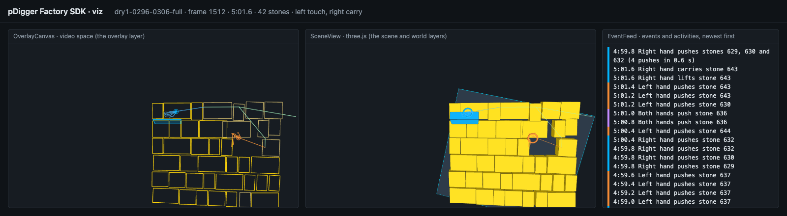

# TypeScript API conventions

<a id="typescript-what-is-particular-to-this-sdk"></a>

Use the SDK across Node, Deno, Bun and browsers. This guide covers cancellation with `AbortSignal`, replay, typed
errors, the three.js views and testing with a fake `fetch`.

## One package, four runtimes

The code uses only standard `fetch`, web streams and ES modules, so the same package runs on Node 18 or newer, Deno 2,
Bun 1 and current browsers; CI runs the built package on Node 18, Deno and Bun. The core has no runtime dependencies,
and `three` is an optional peer dependency of `pdigger-factory-sdk/viz` only. In a browser, the client works from a
page that the unit serves itself: the API sends no CORS headers.

| Import | What |
| --- | --- |
| `pdigger-factory-sdk` | `FactoryClient`, the Interpreter, `Replay`, streams, the low-level `Api`, models, `codec`, errors |
| `pdigger-factory-sdk/viz` | `SceneView`, `OverlayCanvas`, `EventFeed`, `attachToClient` (three.js) |
| `pdigger-factory-sdk/testing` | `FakeFactory` (the API from a recording, as a `fetch`), `InstantClock`, `ManualClock` |

## Async iterables, signals, and leaving a loop

Every call returns a `Promise` and every stream is an `AsyncIterable` for `for await`. Leaving the loop (`break`,
`return`, a throw) closes the HTTP connection, and every call and every iteration takes a `signal`: aborting rejects
with the signal's reason, as `fetch` does.

One Interpreter is one stream, shared by all its consumers (`updates()`, `events()`, `activities()`, `waitFor()`),
and it closes when the last one leaves, so `await factory.interpreter().waitFor("lift")` leaves nothing behind. The
stream goes at the pace of its slowest consumer: give consumers that go at their own pace an Interpreter each. With
TypeScript 5.2 or newer, `using interpreter = factory.interpreter()` and `await using factory = new FactoryClient(url)`
close them at the end of the block. The rest is in [the README's async notes](../../README.md#async-notes).

## Replays without await

`Replay.open()` streams a file with `for await`. `Replay.load()` reads it into memory and adds synchronous methods,
for code that cannot wait ([examples/replay-sync.ts](../../examples/replay-sync.ts)):

<!-- snippet: examples/replay-sync.ts#sync -->
```ts
const replay = await Replay.load(path); // the whole recording in memory: the ...Sync methods work
for (const activity of replay.activitiesSync()) console.log(activity.describe());
const summary = replay.summarySync();
console.log(JSON.stringify(summary.toJSON().moves));
```

and any pass can go at the pace the file was recorded, or faster:

<!-- snippet: examples/replay-sync.ts#pace -->
```ts
// frames at their media times, here twice as fast (a 4.2 s excerpt takes about 2.1 s)
const started = Date.now();
let frames = 0;
for await (const frame of replay.frames({ pace: "realtime", speed: 2 })) frames += frame.world ? 1 : 0;
console.log(`${frames} frames with a world in ${fmt((Date.now() - started) / 1000, 1)} s`);
```

## The three.js views

`pdigger-factory-sdk/viz` turns the interpreter's updates into views: `SceneView` is one three.js group with the
board, the stones, the skeleton, the wrist rings, the work surface and the focus path; `OverlayCanvas` draws the 2-D
overlay on a canvas, in video pixels; `EventFeed` keeps a list of the events. `attachToClient(views, source)` feeds
them from a unit or from a replay. [examples/browser/](../../examples/browser) is a page that replays a recording
into all three:



The scene graph needs no WebGL, so the same views also run in Node, here beside a sink of your own
([examples/viz-node.ts](../../examples/viz-node.ts)):

<!-- snippet: examples/viz-node.ts#headless -->
```ts
import { FactoryClient, type Update } from "pdigger-factory-sdk";
import { SceneView, attachToClient } from "pdigger-factory-sdk/viz";

const factory = new FactoryClient(process.env.PDIGGER_FACTORY_URL ?? "http://factory-orin.local:8120");
const scene = new SceneView();
const log = { update: (u: Update) => u.activities.forEach((a) => console.log(a.describe())) }; // any { update(u) }

const following = attachToClient([scene, log], factory, {
  onUpdate: () => {
    if (following.count === 250) following.stop(); // 250 frames, 50 s of media
  },
});
await following.done;
console.log(`${scene.stoneCount} stones in the scene graph after ${following.count} frames`);
scene.dispose();
```

Install `three` beside the SDK for these (`npm install three`, and `@types/three` for its types). More in
[viz.md](../viz.md).

## Errors, narrowed by code

Every failure of a request or a stream is a `FactoryError` with a `code` that does not change between versions: the
API's own codes and the SDK's (`transport`, `decode`, `live_unavailable`, `live_timeout`, `stream_closed`), the HTTP
`status` when there was one, and the `field` a request was refused for. A timeout or an abort you ask for rejects with
its `DOMException` instead (`TimeoutError` from `waitFor`'s `timeout` or `AbortSignal.timeout`, `AbortError` from an
`AbortController`). `isFactoryError(err, code?)` narrows an `unknown` to it, and
`isRetryable()`, `isNotRetained()` and `isSessionGone()` answer the common questions; the example is in
[the low-level tutorial](02-low-level.md#3-a-stones-track-and-the-focus). Reads are retried by themselves, with
backoff and jitter, on connection errors and on 429, 502, 503 and 504; controls only on 429, which the unit sends
before it applies anything ([low-level.md](../low-level.md#errors)).

## The fake unit is a fetch

`FakeFactory` answers the whole API from a recording, in process: give `fake.fetch` to any client
(`new FactoryClient("http://fake.factory", { fetch: fake.fetch })`) or take `fake.client()`. With `InstantClock`
every wait (backoff, backfill, timeouts) passes at once, and `ManualClock` moves only when your test moves it.
`fake.failNext(operationId, times, reply)` injects faults, and `fake.requests` records every request with its
`operationId`, so a test can check that a program only read, or sent nothing but dry runs. The example is in
[the high-level tutorial](01-high-level.md#7-test-your-program-without-a-unit), and the camera's in
[the live-camera one](03-live-cameras.md#3-test-it-without-a-camera); everything else in [testing.md](../testing.md).

## Types

The package is ES modules with type declarations, which also compile in projects without Node's types. Every schema of
the API is an exported type (`Frame`, `WorldLayer`, `StoneView`, `Overlay2D`, `Scene3D`, `State`, `VideoEntry`, ...),
fields the SDK does not know are kept, and the catalog's entries come as `Source` objects that `JSON.stringify` turns
back into the entry. Integers (`g`, `cursor`, `session`, ids) are JavaScript numbers, exact up to 2^53, far beyond
what a unit produces: the one difference of shape from the other languages. The `codec` returns typed arrays where it can
(`Uint8Array` maps, `Float32Array` depth and mesh positions), so a canvas or a WebGL buffer takes them as they are.
