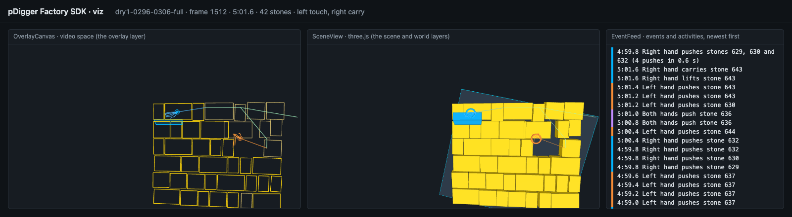
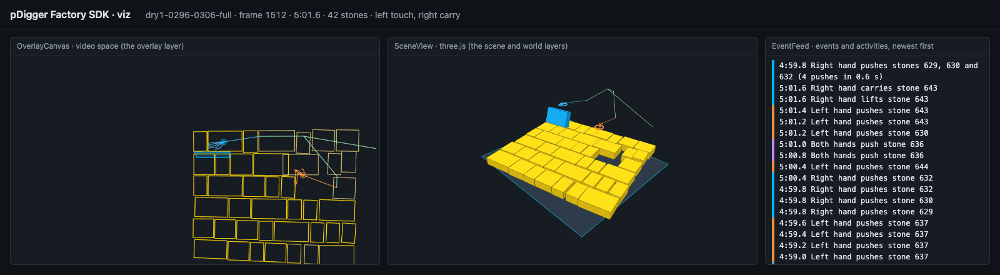

# Visualisation helpers

`pdigger-factory-sdk/viz` draws what the unit sees with three.js, an optional peer dependency (`npm install three`,
r150 or newer; with TypeScript also `npm install @types/three`, which its declarations import). Five pieces:

| | |
|---|---|
| `SceneView` | builds and updates a `THREE.Group` from a render-ready `Scene3D`, a frame, or a world: the board plane, the stones (rect = box, dogbone = the extruded dogbone outline; held and uncertain styles), the skeleton (bones as line segments, null joints skipped), wrist rings, the observed surface mesh (from `surface=vertices`), and the focus path |
| `OverlayCanvas` | draws an `Overlay2D` (`draw=primitives` or shapes) or a frame's overlay layer on a 2-D canvas, scaled from the source's native size to the canvas |
| `EventFeed` | lists the `describe()` lines of events and activities in a DOM element, newest first, with hand colours |
| `attachToClient(views, source)` | drives views from a client (an Interpreter it makes, streaming the world, cards, scene and overlay layers unless `interpreter.layers` names others, and closes when done), an Interpreter (yours: left open), or a Replay, until the updates end or `stop()` |
| `TrayReportView` | a tray's report as a picture: two `SceneView`s side by side, the tray as it arrived and as it left, its stones coloured by what the report says of them, a dashed outline where each removed stone was, and where to put the labels |



The example page ([examples/browser](../examples/browser)) on the fixture recording `dry1-0296-0306-full` (video dry1,
all five layers), stopped at grid frame 1512 (5:01.6): the overlay canvas in video space, the scene from the recording
camera's pose (`source` preset), and the feed.

<!-- snippet: examples/browser/app.js#viz -->
```js
const replay = await Replay.open(options.recording); // or follow a unit: attachToClient(views, factory)
const source = replay.header?.source ?? null; // the catalog entry: camera pose, native size

const scene = new SceneView(); // one THREE.Group: board, stones, skeleton, wrist rings, surface, focus path
const overlay = new OverlayCanvas(overlayTarget, { nativeWh: source?.native_wh ?? [1920, 1080] });
const feed = new EventFeed(feedElement, { max: 400, skip: ["new", "confirm", "freeze"] });

const three = new THREE.Scene();
three.background = new THREE.Color(0x171c22);
const sun = new THREE.DirectionalLight(0xffffff, 1.6);
sun.position.set(1, 3, 2);
three.add(new THREE.HemisphereLight(0xffffff, 0x404850, 2.2), sun, scene.group);
const camera = new THREE.PerspectiveCamera(45, 16 / 9, 0.01, 50);

const attachment = attachToClient([scene, overlay, feed], replay, {
  pace: options.pace ?? "realtime", // frames at their media times
  speed: options.speed ?? 1,
  onUpdate: ({ frame, state }) => {
    if (frame === null) return; // the final update of a replay
    if (camera.userData.preset === undefined && frame.world) {
      camera.userData.preset = options.camera ?? (source?.camera ? "source" : "three");
      scene.applyCamera(camera, camera.userData.preset, source); // after the first world: the board is known
    }
    renderer?.render(three, camera);
    status.textContent =
      `${replay.header?.name ?? "recording"} · frame ${frame.g} · ${clock(frame.t)} · ${state.stones.size} stones · ` +
      `left ${state.hands.left.state ?? "-"}, right ${state.hands.right.state ?? "-"}`;
    if (frame.g >= until) attachment.stop();
  },
});
await attachment.done;
```

To run it: `npm run viz` builds the package and serves this folder on http://127.0.0.1:8130/examples/browser/ (query
`?recording=<url>&pace=none&until=<g>&camera=source|three|top`). The page imports the SDK and three.js through an import
map; in your own app a bundler resolves them.



The same frame with the `three` camera preset (a three-quarter view of the board).

## SceneView

- Axes: the scene is `z` up, three.js `y` up; points map `[x, y, z]` to `[x, z, -y]` (`codec.sceneToThree`), so the
  group can go into any three.js scene as it is.
- `update(input)` takes a `Scene3D` (`renderScene3d`), a `Frame` (its world, scene skeleton and rings) or a
  `WorldLayer`; stones are kept by id and updated in place.
- `applyCamera(camera, preset, source)`: `source` puts a `PerspectiveCamera` at the recording camera's pose (the catalog
  entry's `camera` K, R and t, and its native size for the field of view), so the scene lines up with the video;
  `three` and `top` look at the board.
- `setFocusPath(track)` draws a stone's path (a `StoneTrack` from `getStone`, the session's resolved focus, or points).
- Options: `topology` (bones and colours, default the 20.20 topology), `colors`, and `surface`, `skeleton`, `board` to
  leave parts out. `dispose()` frees every geometry and material.

## TrayReportView

A tray's report (simple mode, `tray.report()`) as a picture, for a tray that has left:

- `show(tray, before, after)`: `before` and `after` are what `SceneView.update` takes (a frame, its world or a
  `Scene3D`) at the tray's arrival point (`tray.arrived.g`) and at its leaving point (`tray.leaving.g`). The two sides
  are `SceneView`s without the skeleton (`view.before` on the left, `view.after` on the right), side by side along x
  with a gap between (option `gap`, 0.3 scene units by default), each centred; `scene` passes options to both.
- Colours (`REPORT_COLORS`, the same as the Rust viewer's): red `#D8432E` removed, blue
  `#1E96C8` added, violet `#6E48B9` moved, green `#0E8A72` sure, amber `#DE7C34` not sure. An unclear removal or
  addition is translucent. The arrival side dims world stones outside the arrival account. The departure side draws
  each stone in the final account at its leaving or last known place, even if the frame omits its solid. On that side a dashed red outline marks each removed stone's final place (`TrayChange.place` and `size`, axis-aligned: its
  long side along x, or along y when its world stone lay that way as the tray arrived).
- `reportMarks(tray)` gives the marks behind the colours, `{ before, after }`, maps by world id: `before` holds every
  stone the tray arrived with, by the world id it was first seen under (in its id, after the tray's number), and
  `after` every stone on the tray as it left, by the world id it stands for then. A mark is `{ stone, role, certain,
  label }`, its label the stone's id after the tray's number for removed, added and moved (the world id it was first
  seen under, with `-2` for a second stone first seen under it in the same tenth of a second), and empty for sure and
  not sure. Each stone's mesh carries its mark as `userData.mark`, for picking.
- `labels()` gives `{ text, color, position, side, mark }` for every labelled stone drawn, `position` its top centre in
  the group's coordinates: project it with the camera to place an HTML label. `bounds(side?)` is the extent of a side
  (or of both), `applyCamera(camera, "top" | "three")` frames both sides (for the group at the scene's origin), and
  `dispose()` frees everything.

The example page's report mode (`?recording=<url>&report=<tray n>`; by default the fixture recording `dry1-0018-0153`,
whose tray 1 arrives at 0:22.5 and leaves at 2:24.0) replays a recording, takes the two worlds and shows them from
above, with the labels, the sides' titles, a legend and the report's text. Each label has two lines: the stone's label,
and under it its change's confidence (`TrayChange.confidence`, the report's change of `mark.stone` in the list of
`mark.role`), as 117 over 0.98; a moved stone shows its move's 0.87 on both sides:

<!-- snippet: examples/browser/app.js#report -->
```js
const replay = await Replay.open(options.recording);
// one pass: every tray of the recording, with its report once it has left
const tray = (await replay.trays()).find((t) => t.n === options.tray && t.report() !== null);
if (tray === undefined) throw new Error(`the recording has no tray ${options.tray} that arrived and left`);
// another: the world at its arrival point and at its leaving point
const worlds = new Map();
for await (const frame of replay.frames()) {
  const point = frame.g === tray.arrived.g || frame.g === tray.leaving.g;
  if (point && frame.session === tray.session && frame.world && !worlds.has(frame.g)) worlds.set(frame.g, frame);
  if (worlds.has(tray.arrived.g) && worlds.has(tray.leaving.g)) break;
}

const view = new TrayReportView(); // two SceneViews side by side: as it arrived, as it left
view.show(tray, worlds.get(tray.arrived.g), worlds.get(tray.leaving.g));
const three = new THREE.Scene();
three.add(new THREE.HemisphereLight(0xffffff, 0x5a6470, Math.PI), view.group); // the roles' own colours on top
const size = view.bounds().getSize(new THREE.Vector3());
const camera = new THREE.PerspectiveCamera(18, size.x / size.z, 0.01, 100);
view.applyCamera(camera, "top"); // straight down on both sides

// a label on each stone removed, added or moved: HTML over the canvas, in its role's colour, two lines: the stone's
// label, and under it its change's confidence from the report (a moved stone has its move's on both sides)
for (const label of view.labels()) {
  const change = view.report[label.mark.role].find((c) => c.stone === label.mark.stone);
  const p = label.position.clone().project(camera); // -1 to 1 across the canvas
  const tag = labelLayer.appendChild(doc.createElement("span"));
  tag.textContent = `${label.text}\n${change.confidence.toFixed(2)}`; // 117, and 0.98 under it
  tag.style.background = label.color;
  tag.style.left = `${((p.x + 1) / 2) * 100}%`;
  tag.style.top = `${((1 - p.y) / 2) * 100}%`;
}
```

## OverlayCanvas and EventFeed

`new OverlayCanvas(canvasOrContext, { nativeWh, topology, colors, image, labels })`; `draw(overlayOrFrame)` returns
what it drew (stones, polygons, segments, circles, labels, images). Map rasters (`image` primitives) are drawn only when
you give `image(url)` that returns something `drawImage` takes.

`new EventFeed(element, { max, events, activities, skip, colors })`; `add(item)`, `addUpdate(update)`, `clear()`,
`lines`. `skip: ["new", "confirm", "freeze"]` gives a calmer feed.

## Without a browser

The helpers need no WebGL to build their scene graph, so they run in Node, for server-side rendering setups or tests:

<!-- snippet: examples/viz-node.ts#headless -->
```ts
import { FactoryClient, type Update } from "pdigger-factory-sdk";
import { SceneView, attachToClient } from "pdigger-factory-sdk/viz";

const factory = new FactoryClient(process.env.PDIGGER_FACTORY_URL ?? "http://factory-orin.local:8120");
const scene = new SceneView();
const log = { update: (u: Update) => u.activities.forEach((a) => console.log(a.describe())) }; // any { update(u) }

const following = attachToClient([scene, log], factory, {
  onUpdate: () => {
    if (following.count === 250) following.stop(); // 250 frames, 50 s of media
  },
});
await following.done;
console.log(`${scene.stoneCount} stones in the scene graph after ${following.count} frames`);
scene.dispose();
```

This SDK's tests build scenes from real frames and check the graph, and draw overlays on a recording 2-D context that
logs every call (`test/unit/viz.test.ts`); the example page's code runs the same way in `test/browser-example.test.ts`.
